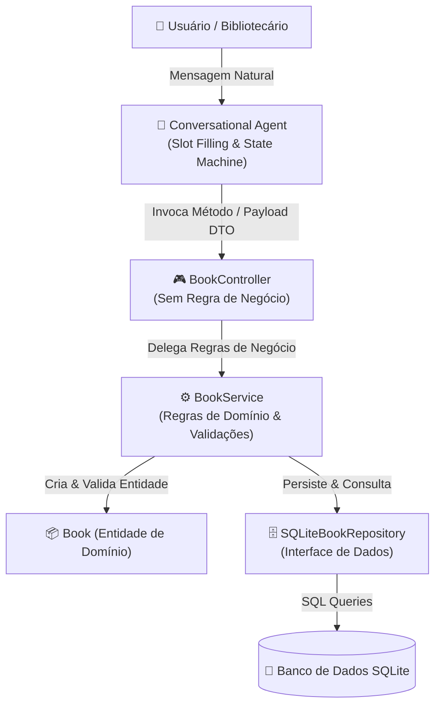
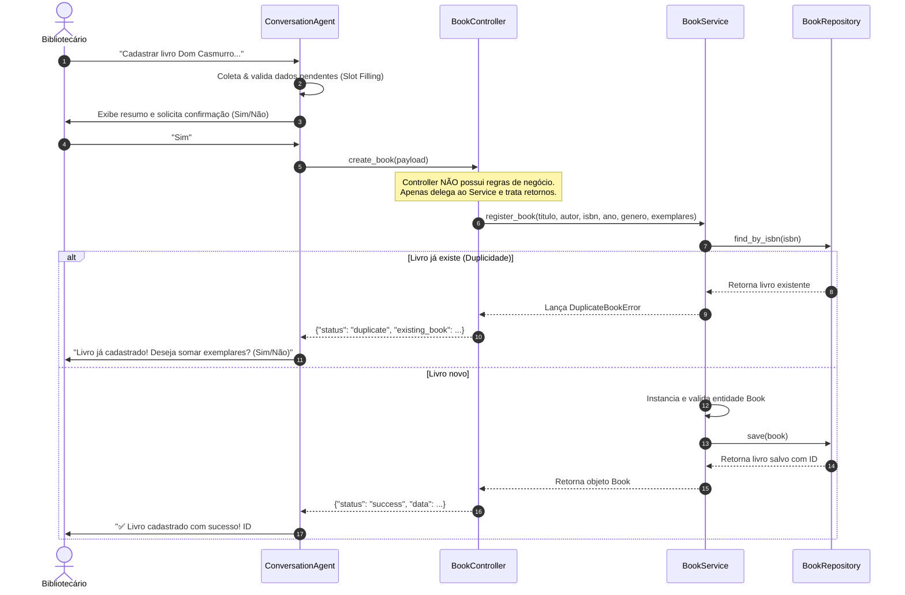

# 🏛️ Agente Conversacional de Gestão de Acervo da Biblioteca

Projeto desenvolvido para a disciplina de **Engenharia de Software (Prática)** com foco na **separação de responsabilidades** e aplicação do padrão arquitetural em camadas **Controller → Service → Repository**, integrado a um **Agente Conversacional Inteligente** para atendimento ao bibliotecário.

---

## 🎯 1. Objetivo do Projeto

Organizar a funcionalidade de **Cadastro de Livros no Acervo** separando claramente as responsabilidades de cada camada do software:
- **Agente / Interface (CLI):** Conduz o diálogo com o bibliotecário humano e gerencia o estado da interação.
- **Controller:** Ponto de entrada da aplicação, orquestra as requisições e formata as respostas **sem conter regras de negócio**.
- **Service:** Concentra todas as **regras de negócio**, validações de acervo e detecção de duplicidades.
- **Repository:** Cuida exclusivamente da **persistência e recuperação de dados** no banco de dados SQLite.

---

## 📊 2. Diagrama da Arquitetura

O fluxo de dados da funcionalidade segue rigorosamente a cadeia unidirecional de dependências:



### 🔁 Fluxo Sequencial da Operação



---

## 📖 3. User Story Escolhida do Backlog

### **US-01: Cadastro de Novos Livros no Acervo via Agente Conversacional**

> **Como** bibliotecário(a) / gestor(a) do acervo,  
> **Quero** conversar com um agente inteligente para registrar novos livros no catálogo da biblioteca,  
> **Para que** o acervo permaneça devidamente catalogado, atualizado e pronto para consulta e empréstimo aos leitores.

### **Critérios de Aceite (BDD / Gherkin)**

* **Cenário 1: Cadastro completo com sucesso**
  * *Dado* que o bibliotecário inicia o cadastro de um livro
  * *Quando* fornecer todas as informações válidas (Título, Autor, ISBN, Ano, Gênero e Quantidade)
  * *E* confirmar o resumo dos dados apresentados pelo agente
  * *Então* o livro deve ser registrado no banco de dados com ID gerado.

* **Cenário 2: Coleta de informações pendentes (Slot Filling)**
  * *Dado* que o bibliotecário informa apenas o título da obra
  * *Quando* o agente processar a intenção
  * *Então* o agente deve guardar o título e solicitar amigavelmente o próximo dado pendente (Autor), repetindo até completar todos os campos.

* **Cenário 3: Validação de entradas inválidas e recuperação**
  * *Dado* que o bibliotecário digita um ISBN inválido ou ano inexistente
  * *Quando* o sistema validar a informação
  * *Então* o erro é apontado e o agente repete a pergunta mantendo os dados anteriores válidos intactos.

* **Cenário 4: Identificação de ISBN duplicado (Incremento de Exemplares)**
  * *Dado* que um livro com o mesmo ISBN já existe no acervo
  * *Quando* o bibliotecário tentar cadastrá-lo novamente
  * *Então* o sistema avisa da duplicidade e oferece a opção de apenas somar os novos exemplares ao registro existente.

* **Cenário 5: Cancelamento da operação**
  * *Dado* que o bibliotecário está no meio do fluxo
  * *Quando* digitar "cancelar"
  * *Então* o agente cancela a operação sem persistir nada no banco de dados.

---

## 🏗️ 4. Estrutura de Pastas e Separação de Camadas

```
.
├── .gitignore
├── requirements.txt            # Dependências do projeto (rich, pytest)
├── README.md                   # Documentação arquitetural e guia de execução
├── main.py                     # Ponto de entrada da aplicação (bootstrap e injeção de dependências)
├── docs/
│   ├── user_story_us01.md      # Especificação detalhada da User Story
│   └── pull_request.md         # Template explicativo completo para a Pull Request
├── src/
│   ├── models/                 # Entidades de Domínio
│   │   ├── __init__.py
│   │   └── book.py             # Classe Book e validações de invariantes de domínio
│   ├── repositories/           # Camada de Acesso a Dados (Repository)
│   │   ├── __init__.py
│   │   └── book_repository.py  # Interface e implementação SQLiteBookRepository
│   ├── services/               # Camada de Regras de Negócio (Service)
│   │   ├── __init__.py
│   │   └── book_service.py     # BookService: validações de negócio, duplicidade e estoque
│   ├── controllers/            # Camada de Entrada e Orquestração (Controller)
│   │   ├── __init__.py
│   │   └── book_controller.py  # BookController: SEM regras de negócio
│   ├── agent/                  # Agente Conversacional
│   │   ├── __init__.py
│   │   ├── intent.py           # Classificação de intenções e extração de entidades
│   │   └── conversation_agent.py # Máquina de estados conversacional e slot filling
│   └── cli/                    # Interface de Linha de Comando
│       ├── __init__.py
│       └── console_chat.py     # Interface interativa no terminal
└── tests/                      # Suíte de Testes Automatizados
    ├── __init__.py
    ├── test_repository.py      # Testes da camada de persistência
    ├── test_service.py         # Testes de regras de negócio
    ├── test_controller.py      # Testes do Controller (garantindo ausência de regra de negócio)
    └── test_user_story_flow.py # Testes dos cenários BDD da User Story
```

---

## ⚖️ 5. Justificativa das Decisões Arquiteturais

1. **Ausência de Regras de Negócio no Controller:**
   O `BookController` atua estritamente como adaptador entre o agente conversacional/interfaces externas e o domínio. Ele não sabe o que é um ISBN duplicado nem como somar estoques; ele simplesmente recebe a requisição, invoca o método adequado do `BookService` e traduz o resultado (ou exceções) em respostas padronizadas (`status`, `data`, `message`).
2. **Camada de Serviço Rica (`BookService`):**
   Toda a inteligência do negócio (verificar se o ISBN já existe, instanciar a entidade válida, somar exemplares) está encapsulada no serviço, permitindo reuso em qualquer interface (API REST, GraphQL, Chatbot ou CLI).
3. **Inversão de Dependência no Repositório:**
   O `BookService` depende de `BookRepositoryInterface`, permitindo trocar facilmente a persistência de SQLite para PostgreSQL, MongoDB ou memória durante os testes automatizados.
4. **Agente Conversacional com Máquina de Estados:**
   Permite tanto a coleta progressiva guiada (*slot filling*) quanto o cadastro em lote (*one-shot input*), com recuperação elegante em caso de falhas de digitação.

---

## 🚀 6. Como Executar o Projeto

### Pré-requisitos
- Python 3.10 ou superior instalado.

### Instalação das Dependências (Opcional)
```bash
pip install -r requirements.txt
```

### Executar o Agente Conversacional Interativo
```bash
python3 main.py
```

### Executar a Suíte de Testes Automatizados
```bash
python3 -m unittest discover -s tests -p "test_*.py" -v
```

---

## 🧪 7. Cobertura de Testes

Os 18 testes automatizados cobrem:
- **Repository:** Inserção, busca por ISBN/ID, atualização de estoque e listagem.
- **Service:** Regras de negócio, detecção de ISBN duplicado e incremento de cópias.
- **Controller:** Delegação para o serviço e formatação de respostas.
- **BDD da User Story:** Cenários 1 a 5 da especificação executados de ponta a ponta.
