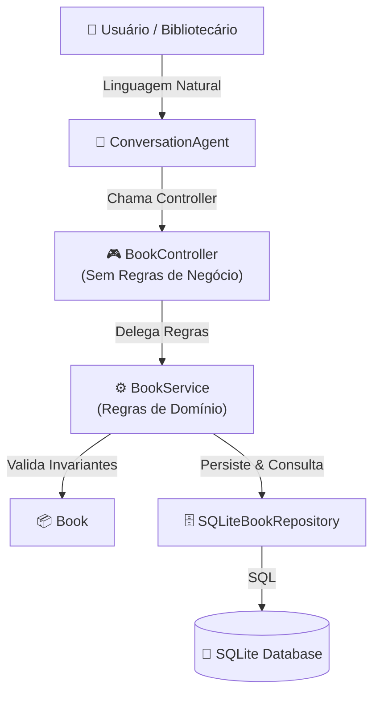

# Template e Descrição da Pull Request (PR)

> **Dica:** Utilize o conteúdo abaixo para preencher o título e a descrição da sua Pull Request no GitHub ao enviar a branch `feature/cadastro-livros-acervo` para a branch `main`.

---

## 📌 Título da Pull Request
`feat: implementa cadastro de livros no acervo com arquitetura Controller -> Service -> Repository (US-01)`

---

## 📝 Descrição da Pull Request

### 🎯 Objetivo
Organizar a funcionalidade de **Cadastro de Livros no Acervo da Biblioteca** (User Story **US-01**) aplicando o princípio de **separação de responsabilidades** através do padrão arquitetural em três camadas: **Controller → Service → Repository**, integrado a um **Agente Conversacional** guiado por máquina de estados e *slot-filling*.

---

### 📋 User Story Contemplada
**US-01: Cadastro de Novos Livros no Acervo via Agente Conversacional**
> **Como** bibliotecário(a) / gestor(a) do acervo,  
> **Quero** conversar com um agente inteligente para registrar novos livros no catálogo da biblioteca,  
> **Para que** o acervo permaneça devidamente catalogado, atualizado e pronto para consulta e empréstimo aos leitores.

---

### 🏛️ Decisões Arquiteturais e Separação de Responsabilidades

O principal objetivo desta entrega foi garantir que cada camada possua uma única e clara responsabilidade:

1. **Camada de Controller (`BookController`):**
   * **Sem Regras de Negócio:** Conforme os requisitos do trabalho, o `BookController` não contém nenhuma lógica de negócio, cálculo de estoque ou validação de acervo.
   * **Responsabilidade:** Receber a requisição/payload (originado do agente conversacional ou CLI), delegar a execução diretamente ao `BookService` e formatar o retorno (sucesso, duplicidade, erro de validação).

2. **Camada de Service (`BookService`):**
   * **Concentrador das Regras de Negócio:** Contém toda a lógica e regras de domínio da aplicação.
   * **Validação de Duplicidade:** Verifica se o ISBN já existe no acervo e levanta exceção de domínio (`DuplicateBookError`).
   * **Gestão de Exemplares:** Provê método específico para incremento de exemplares caso o bibliotecário opte por atualizar o estoque de um livro existente.

3. **Camada de Repository (`SQLiteBookRepository`):**
   * **Persistência e Acesso a Dados:** Implementa a interface `BookRepositoryInterface` (Inversão de Dependência).
   * **Isolamento de Banco:** Cuida das consultas SQL, inserções e atualizações no banco SQLite, mantendo as demais camadas desacopladas do mecanismo de armazenamento.

4. **Agente Conversacional (`ConversationAgent`):**
   * Gerencia a máquina de estados conversacional e a coleta incremental de atributos (*slot filling*).
   * Permite tanto a entrada passo a passo quanto comandos em frase única (*one-shot input*).
   * Comunica-se exclusivamente através do `BookController`.

---

### 📊 Diagrama da Arquitetura



---

### 🧪 Testes e Validação
Foram implementados 18 testes automatizados em `unittest` cobrindo todas as camadas e os 5 cenários BDD da User Story:
- [x] **Cenário 1:** Cadastro completo com sucesso e confirmação
- [x] **Cenário 1 (Variação):** Cadastro direto via frase completa (*one-shot*)
- [x] **Cenário 2:** Coleta incremental de campos pendentes (*slot-filling*)
- [x] **Cenário 3:** Validação de entradas incorretas (ISBN, Ano, Quantidade) e recuperação amigável
- [x] **Cenário 4:** Identificação de duplicidade de ISBN e incremento de exemplares
- [x] **Cenário 5:** Cancelamento seguro a qualquer momento

Comando para execução dos testes:
```bash
python3 -m unittest discover -s tests -p "test_*.py" -v
```
*Resultado: 18/18 testes passando com sucesso.*

---

### 📂 Estrutura de Mudanças
- `src/models/book.py`: Modelo da entidade Book e validação de invariantes.
- `src/repositories/book_repository.py`: Interface e repositório SQLite.
- `src/services/book_service.py`: Camada de regras de negócio e exceções de domínio.
- `src/controllers/book_controller.py`: Camada de Controller magro (sem regras de negócio).
- `src/agent/`: Agente conversacional e classificador de intenções.
- `src/cli/`: Interface interativa de terminal.
- `tests/`: Bateria de testes unitários e BDD.
- `README.md`: Documentação completa com diagrama e instruções.
